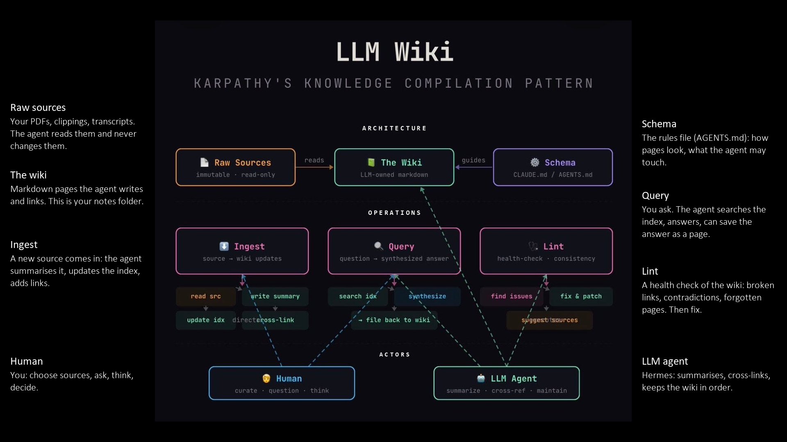
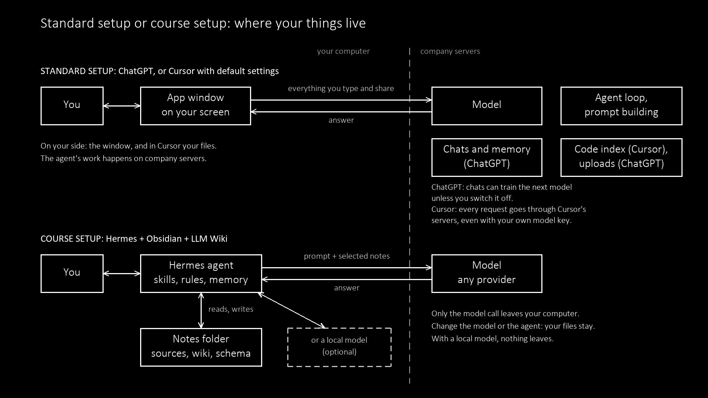

# Deep dive: Default setup

Block 8 of [[../01-welcome-landscape-lecture]]. The personal stack every student builds in the first weeks, a part-by-part reading of the LLM Wiki diagram shown on the slide, the comparison of a standard cloud setup with the course setup from Block 2 (and why the course setup), and one free model to start Hermes with.

Labels: *verified fact* | *technical suggestion* | *course position*.

---

## 1. The stack

| Part | What it is | Set it up |
|---|---|---|
| **Knowledge store** | A folder of plain Markdown notes, synced to your phone. Default: Obsidian. Alternatives are fine if they keep plain files. | [[../../howto-obsidian-setup-and-sync]] · options: [[../../knowledge-store-options]] · SilverBullet: [[../../howto-silverbullet-setup-and-sync]] |
| **Agent** | Hermes Agent (Nous Research, MIT licence). Runs on your computer, reads and writes the notes folder, uses tools and skills. | [[../../howto-hermes-setup]] |
| **Structure** | The LLM Wiki pattern: sources, wiki pages and a schema the agent follows. | [[../../llm-wiki-standard-files]] · background: [[../../../research/karpathy-llm-wiki-and-openclaw]] |
| **Model** | Whatever access you already have (subscription, API key, campus access, or a local model later). | [[../../prompting-and-model-choice]] · Austrian academic access: [[../../academic-ai-austria]] · local hardware: [[../../howto-local-llm-hardware]] |
| **Harness** | Everything around the model that you configure: tools, files, skills, rules. Next session. | [[../../what-is-harness]] · [[../../sessions/02-agent-harness-and-wiki-architecture]] |

Related: [[../../what-is-mcp]] (Model Context Protocol: connecting the agent to other apps, Session 05) · [[../../what-is-lint]] (checking the wiki) · [[../../student-share-structure]] (what the course shares) · Obsidian versus Joplin: [[../../../research/obsidian-vs-joplin-hermes-llmwiki]].

*course position:* Notes sync to the phone through Obsidian and a cloud folder. Hermes runs on the computer; the phone does not need it.

---

## 2. The diagram: "LLM Wiki: Karpathy's knowledge compilation pattern"

Source image: https://miro.medium.com/v2/0*XgW6DseQg1v0s88q.jpg (published on Medium; author not identified on the image). It draws Andrej Karpathy's *LLM Wiki* idea file (gist, 4 April 2026): https://gist.github.com/karpathy/442a6bf555914893e9891c11519de94f

The slide version (`14-llm-wiki-annotated.png`) puts a short note next to each part and repaints the three row labels in white. The notes on the slide:

| Part | Note on the slide |
|---|---|
| Raw sources | Your PDFs, clippings, transcripts. The agent reads them and never changes them. |
| The wiki | Markdown pages the agent writes and links. This is your notes folder. |
| Schema | The rules file (AGENTS.md): how pages look, what the agent may touch. |
| Ingest | A new source comes in: the agent summarises it, updates the index, adds links. |
| Query | You ask. The agent searches the index, answers, can save the answer as a page. |
| Lint | A health check of the wiki: broken links, contradictions, forgotten pages. Then fix. |
| Human | You: choose sources, ask, think, decide. |
| LLM agent | Hermes: summarises, cross-links, keeps the wiki in order. |

The diagram has three rows: **Architecture** (what exists), **Operations** (what happens), **Actors** (who does it).

### Row 1: Architecture

| Box | Label on the diagram | What it means | In the course folder |
|---|---|---|---|
| **Raw Sources** | "immutable · read-only" | Everything you collect: articles, PDFs, transcripts, screenshots, clippings. The agent reads them but never changes them, so you can always check a claim against the original. | `raw/` (Obsidian web clipper output goes here) |
| **The Wiki** | "LLM-owned markdown" | The pages the agent writes from your sources: summaries, people, concepts, comparisons. Linked with each other. | `entities/`, `concepts/`, `comparisons/`, `queries/`, plus `index.md` and `log.md` |
| **Schema** | "CLAUDE.md / AGENTS.md" | The rules the agent must follow: topic, file names, tags, when to make a new page, which folders are human-only. | `SCHEMA.md` in Hermes (same job as `CLAUDE.md` or `AGENTS.md`) |

The two arrows: the wiki **reads** the raw sources, and the schema **guides** the wiki. Sources supply content; the schema supplies form.

### Row 2: Operations

| Operation | Label | Steps shown | What happens in practice |
|---|---|---|---|
| **Ingest** | "source → wiki updates" | read src · write summary · update idx · cross-link | You drop a new source in `raw/` and ask the agent to ingest it. It reads the source, writes or updates the relevant pages, adds them to `index.md`, links them to existing pages, and notes the action in `log.md`. One source can touch ten pages. |
| **Query** | "question → synthesized answer" | search idx · synthesize · file back to wiki | You ask a question. The agent reads `index.md` first, opens the pages it needs, and answers with links to them. A good answer can be saved back into the wiki under `queries/`, so the next question starts from it. |
| **Lint** | "health-check · consistency" | find issues · fix & patch · suggest sources | A regular check-up: broken links, pages missing from the index, contradictions between pages, stale claims. The agent fixes what is mechanical and suggests new sources where knowledge is thin. See [[../../what-is-lint]]. |

Some small labels overlap in the image ("direct", "suggest sources"); the three steps per operation above are the readable ones.

### Row 3: Actors

| Actor | Label | Role | Dashed lines in the diagram |
|---|---|---|---|
| **Human** | "curate · question · think" | You choose what goes in, ask the questions, and judge the answers. | To **Ingest** and **Query**: you start both. |
| **LLM Agent** | "summarize · cross-ref · maintain" | The agent does the filing: summaries, links, index, repairs. | To **Query**, **Lint** and directly to **The Wiki**: the agent answers, maintains, and writes the pages. |

### What the diagram does not show

- **Authorship.** In pure Karpathy style the agent writes almost every wiki page. In this course your own voice stays in human-only pages that the schema protects ([[../../llm-wiki-standard-files]]).
- **Scale.** Reading `index.md` first works up to a few hundred pages. Larger collections need search or retrieval tools.
- **Errors.** A wiki built from weak sources becomes a confident wiki of weak claims. Lint helps; reading the pages yourself is still necessary.
- **Where it runs.** The diagram is silent about the model. The same wiki works with a cloud model or a local one.

*verified fact (Karpathy gist):* "Obsidian is the IDE; the LLM is the programmer; the wiki is the codebase."

---

## 3. Standard setup or course setup: where your things live

The diagram (Block 2 of the lecture, slide 10) compares the setup most people use with the one this course builds. The dashed line separates your computer from company servers.

### The standard setup: ChatGPT, or Cursor with default settings

| Part | ChatGPT (personal account) | Cursor (default settings) |
|---|---|---|
| On your computer | The app or browser window | The editor window and your project files |
| Agent loop and prompt building | OpenAI's servers | Cursor's servers. *verified fact (cursor.com/data-use):* requests go through Cursor's backend for final prompt building even when you use your own model key. Cloud agents run their whole loop in Cursor's cloud |
| Chats and memory | OpenAI's servers | Chat history mostly local; cloud-agent runs on Cursor's servers |
| Index of your material | Uploaded files on OpenAI's servers | *verified fact (cursor.com/data-use):* codebase indexing stores embeddings and obfuscated file paths on Cursor's servers |
| Training | *verified fact (OpenAI Data Controls FAQ):* "Improve the model for everyone" is **on by default** for Free, Plus and Pro accounts; chats can train future models unless you switch it off | *verified fact (cursor.com/data-use):* without Privacy Mode, Cursor may store and use prompts and code to improve its products |

The harness (rules, memory, the agent loop) sits partly or wholly on the company's side. You can switch to another product, but your history and memory do not come along.

### The course setup: Hermes, Obsidian, LLM Wiki

| Part | Where it lives |
|---|---|
| The agent (Hermes) with its skills, rules and memory | Your computer, as files |
| The notes folder: raw sources, wiki pages, schema | Your computer, synced to your phone through a folder you choose |
| The model | Any provider through an API key, a free tier, or a local model (Ollama, LM Studio) |

Only the model call leaves your computer: the prompt plus the notes the agent selected for it. With a local model, nothing leaves.

### Why the course setup (slide 11)

1. **Your data stays with you.** Notes, memory and skills are files on your own disk. *course position.*
2. **You set the limits.** The schema and the Hermes tool settings decide which folders the agent may read, which it may write, and which stay human-only. Raw sources are read-only by rule. ([[../../llm-wiki-standard-files]])
3. **Easy to switch.** Skills, rules and memory are local files, so you can change the agent (Hermes, Claude Code, Cursor, a plain editor) or the model and keep them. Session 02 ([[../../what-is-harness]]).
4. **No lock-in.** Plain markdown opens in any editor, with or without AI, in ten years too.
5. **You can check it.** Every page the agent wrote is a file you can open, compare and undo; `log.md` records what it did.
6. **Model by choice.** A paid cloud model, a free tier, or a local model for private notes. Offline work is possible with a local model.

Limits, said aloud in class: the model call still goes out unless you run a local model; free tiers can log prompts; a local agent needs upkeep (updates, keys, backups); and Hermes itself is software you trust with your files.

### Cloud model or local model inside the course setup

The same setup works with a model in the cloud or a model on your own computer. The difference is where your notes travel.

| Step | Cloud model | Local model |
|---|---|---|
| You ask | You type a request to the agent. | Same. |
| The agent reads | Hermes runs on your computer and opens the notes it needs from your knowledge base. | Same. |
| The agent sends | It sends your prompt **plus the notes it selected** over the internet to the provider's servers. | It sends the same to a model running on your computer (for example through Ollama or LM Studio). |
| The model answers | On the provider's servers, under the provider's terms: storage, logging, sometimes training. | On your machine. Nothing leaves it. |
| The agent writes | Back into your notes folder. | Same. |

Three points to take away:

1. **The knowledge base itself stays on your computer in both cases.** What leaves, in the cloud case, is the prompt and every note the agent attaches to it. One question can carry ten private pages.
2. **Your schema decides what the agent may send.** Human-only and private folders in `SCHEMA.md` are also a privacy boundary ([[../../llm-wiki-standard-files]]).
3. **Local costs memory, not money per request.** Smaller models, slower answers, limited by RAM and GPU. Hardware paths: Session [[../../sessions/03-hardware-open-models-prompting|03]] · [[../../howto-local-llm-hardware]].

*verified fact (OpenRouter, Nov 2026):* Free endpoints are rate-limited, and their providers may log prompts. Check the data policy of a free model before you send private notes through it.

---

## 4. A free model for Hermes

To test Hermes without paying, the course suggests one free, open model. *technical suggestion*, checked 10 Nov 2026:

**NVIDIA Nemotron 3 Ultra through OpenRouter's free tier**, model ID `nvidia/nemotron-3-ultra-550b-a55b:free`.

- *verified fact (OpenRouter, NVIDIA):* Released 4 June 2026. Weights published under OpenMDW 1.1, a permissive open licence. *claim (NVIDIA):* training data and recipes are published as well, which would make it more open than most "open-weight" models.
- *verified fact (OpenRouter):* $0 per token, tool calling, context up to 1 million tokens, built for long agent tasks. Rate limits: 20 requests per minute, 50 requests per day (1,000 after a one-time credit purchase). Hermes needs at least 64,000 tokens of context and tool calling.
- *verified fact (Hermes docs):* Nous Research is part of NVIDIA's Nemotron Coalition, and the Hermes docs carry a dedicated guide for running Nemotron 3 Ultra free.
- Setup: create a free OpenRouter account and key, put it in `~/.hermes/.env` as `OPENROUTER_API_KEY`, run `hermes model`, choose OpenRouter and the model ID above. Keep the key out of your notes. Steps: [[../../howto-hermes-setup]].
- 550 billion parameters (55 billion active per step): far too large for a laptop. The model is open, but in this setup it still runs in the cloud, so the privacy points in §3 apply.

Fallbacks: the free plan of Nous Portal (`hermes setup --portal`, free models only, no payment) or a small local model through Ollama if your computer has the memory (Session 03).

---

## 5. Homework

1. Bookmark or clone the course GitHub: [[../../START-HERE]].
2. Install a knowledge store with phone sync. Default Obsidian: [[../../howto-obsidian-setup-and-sync]]. Alternatives: [[../../knowledge-store-options]].
3. Write down which AI access you already have (subscriptions, API keys, campus access).
4. Read Karpathy's LLM Wiki gist or watch the beginner setup guide linked in [[../../references]]. If you do not want to use AI: you can do research, investigative work on AI and input lectures.
5. Optional, if you are ready: install Hermes Agent and point it at your notes folder ([[../../howto-hermes-setup]]). Otherwise we install it together in Session 02.
6. Choose your student-input group and session ([[../01-welcome-landscape-lecture#Student inputs: choose a topic]]).

Next session: Karpathy and the harness, after the flattening input, then the Hermes install ([[../../sessions/02-agent-harness-and-wiki-architecture]] · [[../../course-rhythm]]).

---

## Sources

- Karpathy, *llm-wiki.md* gist: https://gist.github.com/karpathy/442a6bf555914893e9891c11519de94f
- Hermes Agent LLM Wiki skill: https://hermes-agent.nousresearch.com/docs/user-guide/skills/bundled/research/research-llm-wiki
- Hermes Agent install: https://hermes-agent.nousresearch.com/docs/getting-started/installation
- Diagram image: https://miro.medium.com/v2/0*XgW6DseQg1v0s88q.jpg
- Hermes Agent providers: https://hermes-agent.nousresearch.com/docs/integrations/providers
- OpenRouter, Hermes Agent setup: https://openrouter.ai/blog/tutorials/hermes-agent/
- Nemotron 3 Ultra (free) on OpenRouter: https://openrouter.ai/nvidia/nemotron-3-ultra-550b-a55b:free
- Nemotron 3 Ultra model card: https://huggingface.co/nvidia/NVIDIA-Nemotron-3-Ultra-550B-A55B-BF16
- OpenMDW licence FAQ: https://openmdw.ai/faq/
- Hermes guide, Nemotron 3 Ultra free: https://hermes-agent.nousresearch.com/docs/guides/run-nemotron-3-ultra-free
- Cursor, data use and privacy: https://cursor.com/data-use
- OpenAI, Data Controls FAQ: https://help.openai.com/en/articles/7730893-data-controls-faq
