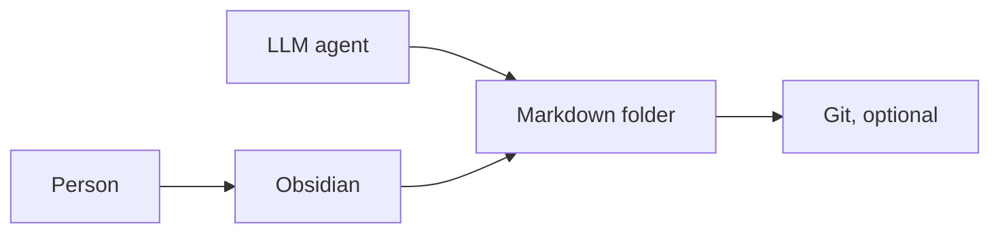
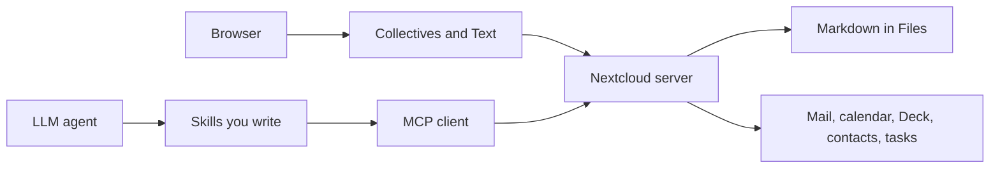

# LLM Wiki + Obsidian vs Nextcloud Collectives + MCP

Research date: 2026-10-18. Revised the same day after a scope clarification. Labels: *verified fact* | *technical suggestion*.

Objective comparison of two ways to keep a knowledge base that an LLM can work on:

- **LLM Wiki + Obsidian** — Andrej Karpathy’s pattern (gist, 4 April 2026): a folder of markdown the agent maintains, read in Obsidian. Ingest, query, lint, `index.md`, and `log.md` are part of the published pattern.
- **Nextcloud Collectives + MCP** — a self-hosted, AGPL team wiki, with an agent attached through the Model Context Protocol. In the setup this note evaluates, weekly summaries and similar wiki habits are **skills a person writes**. They are not features Collectives or Context Agent ship.

This note does not pick a winner. It records what each stack actually does, then the trade-offs.

## How the Nextcloud side is scoped

*technical suggestion:* Treat the Nextcloud stack as a personally assembled system.

What you get from the software: Nextcloud as the account, Collectives as the shared markdown wiki, and **one MCP server** as the agent’s interface. Mail, calendar, Deck, tasks, contacts, files, and collective pages are tools on that server, once the matching Nextcloud apps are installed. They are not separate MCP servers.

What you build yourself: the agent’s habits. A weekly summary, an ingest pass, a lint pass, a rule for “new page versus append,” and a rule for when to open mail versus the wiki are skills, cron jobs, or Flow rules. The LLM Wiki gist already writes those habits down as a schema. On the Nextcloud side their absence is expected, and it is a real cost.

## Short version

| | LLM Wiki + Obsidian | Nextcloud Collectives + MCP |
|---|---|---|
| What it optimizes | A compounding, inspectable wiki with a published maintenance routine. | One Nextcloud account for shared writing and for live apps (mail, calendar, Deck, files), with wiki routines added as skills. |
| Store | A folder of markdown on disk. Often a git repo. | Markdown files on the Nextcloud server, plus team membership and page structure in the Nextcloud database. |
| Who owns a page | Whoever owns the folder or the git repo. | The collective is owned by a Nextcloud Team, not by one user. |
| How people co-edit | Git, or file sync. Two writes to the same file conflict. | Nextcloud Text: collaborative editing in the browser, with live cursors. |
| How the agent sees data | It reads and writes the wiki folder. Mail, calendar, and Deck are outside that folder. | One MCP server is the interface. Those apps are tools on it. The model calls a tool when a skill or the question asks it to. |
| Wiki method | Ingest, query, lint, index, and log are in the gist. | You write the equivalent skills. |
| Open source | The pattern and the files are open. The Obsidian app is proprietary (free to use, including at work). | Nextcloud Server, Collectives, and Context Agent are AGPL-3.0-or-later. |
| Needs a server | No, for a single machine. Sync across devices is a separate choice. | Yes. The web UI and the MCP endpoint need the server up. |

## What each one is

### LLM Wiki + Obsidian

*verified fact:* Karpathy’s `llm-wiki.md` (4 April 2026) is an idea file, meant to be pasted to an agent. It is a pattern for a personal knowledge base, not a product. Source: https://gist.github.com/karpathy/442a6bf555914893e9891c11519de94f

Three layers:

1. **Raw sources** — articles, papers, clippings. Immutable. The agent reads them and does not edit them.
2. **Wiki** — markdown the agent writes: summaries, entities, concepts, synthesis. The agent owns this layer.
3. **Schema** — a file such as `AGENTS.md` or `CLAUDE.md` that states conventions for ingest, query, and lint.

Three operations: **ingest** a source (often touching many pages), **query** the wiki and file good answers back as new pages, **lint** for contradictions, orphans, and stale claims.

At moderate scale (about 100 sources, a few hundred pages) an `index.md` is the catalog the agent reads first. The gist treats that as enough to skip a vector database. A `log.md` is an append-only history of ingests, queries, and lint passes.

The line from the gist: *“Obsidian is the IDE; the LLM is the programmer; the wiki is the codebase.”* The same paragraph says the wiki is a git repo of markdown. Obsidian is the viewer he uses (graph, links, clipper). The note at the end says the directory layout and tools are optional.

The gist also names a **team** use: an internal wiki maintained by LLMs from meeting notes, project documents, and similar, with humans reviewing updates. The mechanism he names for collaboration is git, not a multi-cursor editor.

*verified fact:* Obsidian is free for personal, non-profit, and commercial use. A Commercial license is optional support, not a requirement (change dated 20 February 2025). Paid add-ons are Sync and Publish. The application itself is proprietary. https://obsidian.md/license · https://obsidian.md/blog/free-for-work/

Wikilinks (`[[Page]]`), the graph view, and the Web Clipper are Obsidian features. Dataview (community plugin) queries YAML frontmatter if the agent writes it. The gist recommends that combination. Frontmatter is a convention of the wiki, not something Obsidian requires.

### Nextcloud Collectives + MCP

*verified fact:* Collectives is an AGPL knowledge app. Each collective is backed by a Nextcloud Team. Pages are collaborative markdown edited with the Text app. https://github.com/nextcloud/collectives

*verified fact:* Pages are markdown files in the Files app. The default folder is hidden (`.Collectives`, or a translated name). A per-user setting can rename it, for example to `Collectives`. https://docs.nextcloud.com/server/stable/user_manual/en/collectives/markdown_files.html

*verified fact:* Nextcloud Server is AGPL-3.0-or-later. https://github.com/nextcloud/server/blob/master/COPYING-README

*verified fact:* Context Agent is AGPL-3.0-or-later. It supplies the Assistant’s tool calls and an MCP endpoint for outside agents. It does not include a model. https://github.com/nextcloud/context_agent

Links inside a collective are Collectives links, inserted with “Link to page”, drag-and-drop, or the smart picker. They look like `/apps/collectives/<collective>/<page>?fileId=<id>`. A backlinks list exists in the page sidebar. `[[wikilinks]]` are not the Collectives link syntax. Relative links such as `[document](document.md)` do not open the collective page.

Permissions sit on the collective (the team), not on each page. The project’s own gap list still marks per-folder and per-page permissions, and custom metadata fields, as open. https://github.com/nextcloud/collectives/issues/482 (issue updated through 2026)

**One server, many tools.** *verified fact:* Context Agent is a single MCP server. The admin manual says the app makes its tools available via an MCP server, at one URL. Calendar, tasks, contacts, Collectives, Deck, files, and mail are tool groups on that server. A group shows up when its Nextcloud app is installed, and an admin can switch groups on or off. The agent configuration contains one Nextcloud entry, not a mail server plus a calendar server plus a Deck server. https://docs.nextcloud.com/server/stable/admin_manual/ai/app_context_agent.html

The same shape exists in third-party servers that talk to one Nextcloud: [cbcoutinho/nextcloud-mcp-server](https://github.com/cbcoutinho/nextcloud-mcp-server/) and [cloud-py-api/nc_mcp_server](https://github.com/cloud-py-api/nc_mcp_server) each register many app tools on one process. You run one of these, or Context Agent. You do not stack one MCP per app.

**MCP here means a protocol, not a memory.** *verified fact:* With Context Agent installed, outside agents use:

`https://<your-nextcloud>/index.php/apps/app_api/proxy/context_agent/mcp/`

Auth is an app password. It is an external app (AppAPI), installed with a deploy daemon. Documented tools include Collectives (list, read, create, replace, rename, move, trash), files, calendar, tasks, contacts, Deck, and mail (list accounts, folders, and messages; send). The model combines tools by calling them. The admin manual says this app cannot currently be scaled. https://docs.nextcloud.com/server/stable/admin_manual/ai/app_context_agent.html

## Claim check

Three reasons to prefer the Nextcloud setup, checked against the docs and against the manual-skill scope above.

### 1. One place for the agent’s work

**Claim.** Emails, calendar, Deck, and git repos whose working folders also sit in synced Nextcloud folders are one source for the agent.

**Verdict.** Holds for the Nextcloud apps. Holds only in part for git.

*verified fact:* Context Agent’s tool list covers mail, calendar, Deck, the Tasks app, contacts, files, and Collectives, each when that app is installed. One Nextcloud account and one MCP URL are enough for an agent to be told “look at the inbox, the week’s events, the Deck board, and the collective.”

*verified fact:* That URL is one interface. A sentence such as “mail and calendar are separate MCP servers you add” does not describe this setup. Installing the Mail app or the Calendar app enables another tool group on the same server. The agent still has a single MCP entry.

On the LLM Wiki side the wiki folder does not contain the inbox or the calendar. Reaching them means attaching this same Nextcloud MCP, once. It does not mean registering a separate server per app.

Limits that stay true while the setup is manual:

- The endpoint is a menu of tools. A skill still has to say when the agent should open mail, when it should open the wiki, and what it should write back. Nothing in the admin manual loads the whole mailbox into every prompt.
- Official mail tools list accounts, folders, and messages, and they can send. A full “read this thread and file a summary” skill is something you write on top of that list.
- **Git is a second system.** Files MCP can read and write the working tree if those folders are in Nextcloud. It does not provide git log, diff, commit, or branch. History stays in git. “Also a git repo” and “visible to the Nextcloud agent” are two facts at once.
- *verified fact:* If the same file changes locally and on the server between sync runs, the desktop client writes a conflicted copy and leaves the merge to a person. https://docs.nextcloud.com/server/stable/user_manual/en/desktop/conflicts.html
- *technical suggestion:* Community reports treat syncing a `.git` directory through that client as a common way to hit those conflicts, because a commit rewrites many small files. Working files can live in the synced folder. The `.git` directory is safer excluded from sync, with the remote (GitHub or similar) keeping history. That split matches “folders in Nextcloud, and also git” better than syncing the git database itself.

### 2. A wiki people can read, and a wiki several people can edit

**Claim.** The collective is human-readable, and several people can work on one Collectives wiki. Obsidian can also be the reader.

**Verdict.** The team half holds. The readability half holds for both, with a different audience.

*verified fact:* Collectives renders markdown in the browser: page tree, full-text search, backlinks, versions. Someone in the team opens it without installing Obsidian. Text supports collaborative editing and live cursors. Instant push uses the Files high-performance backend when that backend is installed. https://nextcloud.com/blog/websockets-in-nextcloud/

*verified fact:* Each collective is owned by a Nextcloud Team. That is group ownership, which a personal Obsidian vault does not have.

Obsidian is also a human-readable rendering of the same kind of prose, and for one person it is the stronger reading and writing environment: local speed, wikilinks, graph, splits, clipper. The advantage of Collectives is who can arrive. A teammate gets the shared page in a browser. An Obsidian shared vault (paid Sync, or git, or a synced folder) still shares files. Two people in the same paragraph at the same time are in conflict-copy or merge territory.

Limits:

- Rights are on the whole collective. Per-page permissions are still an open item on the project’s gap list.
- An agent skill that replaces a page can overwrite a person who is editing it. The official “replace the content” tool replaces the body and appends a note that the Assistant edited the page.
- Collectives links are `fileId` URLs. They read well inside Collectives. They read poorly in Obsidian or in a plain git diff.

### 3. Open source is stronger than Obsidian

**Claim.** The Nextcloud setup is more strongly open source than Obsidian.

**Verdict.** Holds for the software you host. It does not make the notes, or the model, automatically more open.

*verified fact:* Nextcloud Server, Collectives, and Context Agent are AGPL-3.0-or-later. You can run them, read them, and change them. Obsidian is proprietary. Use of the app is free for personal and commercial work; the source is not available to patch.

What stays open on the Obsidian side anyway: the LLM Wiki text is a public gist, and the vault is ordinary markdown. You can leave Obsidian and open the folder in another editor. What is closed is the application: graph, sync client, clipper, and the editor.

What stays closed, or at least not settled, on the Nextcloud side:

- The language model is a separate choice. Context Agent’s own rating says the app contains no model. An OpenAI key or an open-weight model can sit behind either stack.
- Collectives pages are markdown, so the prose can leave the server. The link format (`fileId` URLs) and the team metadata in the database travel less cleanly than an Obsidian vault of `[[wikilinks]]`. Open source of the app and portable notes are two different properties.

## Pros and cons

Standardization is a pro of the LLM Wiki and a con of the Nextcloud assembly. One account for live apps, team editing, and an AGPL host are pros of Nextcloud. Those are allowed to stand at the same time.

### LLM Wiki + Obsidian

| Pros | Cons |
|---|---|
| Ingest, query, lint, `index.md`, and `log.md` are already specified. A new agent session can be pointed at the gist and the schema. | The Obsidian application is closed source. Use is free; you cannot patch the app. |
| Local reading and writing. The vault works with no network. | The published pattern stops at the folder. Mail, calendar, and Deck enter through one attached Nextcloud MCP, which the gist does not include. |
| Every agent edit is a markdown diff. Git gives history, branches, and review. | Two people, or a person and an agent, writing the same file at once produce a merge or a sync conflict. |
| Fast keyboard writing: command palette, splits, optional Vim mode. | A shared team practice is “the agent writes, people review commits.” Several people in one paragraph need another tool. |
| Graph view shows hubs and orphans. The gist treats this as the way to see the shape of the wiki. | Plugins and the graph are per device. A new computer needs Obsidian, and any plugins, set up again. |
| Web Clipper (including mobile Safari) turns articles into raw sources. | Official Sync and Publish are paid. Free sync means you run your own (folder sync, Syncthing, git). |
| At the scale the gist describes, `index.md` avoids standing up a vector database. | Paid Sync can share a vault and keep version history. That share is still file sync. |
| The pattern does not require Obsidian. Any editor that opens a folder can be the viewer. The files stay ordinary markdown. | There is no group object. “Who may edit this wiki” is whoever has the folder, the git remote, or the Sync seat. |

### Nextcloud Collectives + MCP

| Pros | Cons |
|---|---|
| One MCP server is the agent’s interface to collective pages, files, mail, calendar, Deck, tasks, and contacts. Each app is a tool group on that server, not its own MCP server. | Wiki habits are yours to write. Weekly summaries, ingest, lint, and “when do I open the inbox” are skills, not a schema the product includes. |
| Several people can edit one collective, including the same page, in the browser. The collective belongs to a team. | The Collectives UI is a browser app. Large pages and a slow link feel slower than a local editor. |
| Teammates can read the wiki without Obsidian. Page tree, search, backlinks, and versions are in the web app. | There is no Collectives graph view, and pages do not use `[[wikilinks]]`. |
| Server, Collectives, and Context Agent are AGPL. A group can host them and change them. | The language model is still a separate install. AGPL on the host does not make the model open. |
| One server update reaches every browser. Clients do not each install Collectives. | If the server is down, the web UI and the MCP endpoint are down. |
| Working files that live in Nextcloud are visible to the files tools, including trees that are also git checkouts. | Git operations are not Nextcloud tools. Syncing the `.git` directory through the desktop client is a known way to earn conflicted copies. |
| Full-text search and a versions sidebar ship with the app. | Per-page permissions and custom metadata fields are still open gaps. Frontmatter is not a structured page database yet. |
| | Context Agent needs AppAPI and a deploy daemon. The manual says it cannot currently be scaled, and answer quality depends on the model. |
| | The project’s gap list marks a dedicated Collectives mobile app as missing. Phone use goes through Nextcloud’s file and direct-editing apps. |
| | A skill that replaces a page can overwrite a live editing session. Replace writes the whole body, then an “edited with the Assistant” note. |

*verified fact* on live editing: Nextcloud’s WebSockets write-up says Collectives and Deck update through Text, and that this real-time path uses the Files high-performance backend. https://nextcloud.com/blog/websockets-in-nextcloud/

## Where a common write-up overreaches

These claims show up in comparisons of the two stacks. The docs say something narrower. The manual-skill scope does not repair the first rows.

| Claim | What the sources support |
|---|---|
| Both stacks already share one store of markdown with the same YAML frontmatter. | Both can store prose as `.md`. Collectives links, page order, emoji, and team membership are not that frontmatter. Nextcloud Text can display a leading frontmatter block as a code block (Text pull request 2751, merged 2022). It does not turn those keys into page fields. The Collectives gap list still has “page metadata (could be md frontmatter)” and “custom metadata fields” unchecked. On 8 January 2026 a maintainer said they will most likely move more metadata into frontmatter later. https://github.com/nextcloud/collectives/issues/2185 |
| Collectives resolves links through the rights system. | Rights decide who may open the collective. A link target is a Collectives URL with a `fileId`. |
| The LLM is wired into the server so that mail, calendar, Deck, and contacts are always in context. | They are tools on one MCP server. A skill decides when the model calls one. The manual does not load every mailbox into every prompt. |
| Weekly curation ships with Collectives. | It does not. In the setup this note evaluates, a weekly summary is a skill you add. That is a maintenance cost next to the LLM Wiki schema, and it is also the intended design. |
| Collectives has removed the usual limits of a web wiki, so the only remaining question is taste. | Collaborative markdown and a broad MCP tool list are real. Graph, wikilinks, structured frontmatter, per-page rights, and a first-class phone app are still different from Obsidian. |
| An Obsidian agent can only ever see the vault. | The filesystem pattern starts at the folder. Karpathy’s gist also points at `qmd`, which can run as one search MCP. Mail, calendar, and Deck from this Nextcloud are another single MCP entry, the same Context Agent URL, not one server per app. |

## Using both on the same files

*technical suggestion:* Pointing Obsidian at a synced copy of a collective is possible only after the collective folder is actually synced to disk, and it is a second editor on those bytes.

What still differs if you do that:

- Link syntax. Obsidian wants `[[Page]]` or a relative path. Collectives wants a `fileId` URL. A page written in one tool looks broken in the other.
- Two writers. A Text session and an agent that replaces the file will overwrite each other.
- The LLM Wiki layout (`raw/` immutable, agent-owned wiki, `index.md`, `log.md`) is a folder convention. Collectives is a page tree with a landing page. You would teach the agent that tree in a skill, or keep the LLM Wiki outside the collective.

A third Nextcloud app, [Opensidian](https://github.com/markusbegerow/nextcloud-opensidian), adds `[[wikilinks]]` and a graph to a normal markdown folder inside Files. That is a different product from Collectives.

## Weekly summaries

On the Nextcloud side this is a skill, by design.

- **LLM Wiki.** The gist already has a place for it. Ingest and lint update existing pages and can add new ones. A weekly pass goes in the schema: “write `wiki/weekly/2026-10-18.md`” or “append a dated section to `wiki/log.md`.” `log.md` is the append-only form. Synthesis pages are the new-page form.
- **Collectives + a skill.** Documented tools can create a page under a parent, or replace a page’s content. The skill states which of those the weekly job uses. Replace is a full replacement plus an automatic “edited with the Assistant” note. An append-only section is an extra instruction in the skill, or a Flow/cron job.

*technical suggestion:* New pages keep history readable and match “file the answer back into the wiki.” Appending suits a single running log. Replacing a page suits a status page that should describe the present and nothing else. Writing that choice into a skill is the Nextcloud equivalent of a paragraph in `AGENTS.md`. The difference is that the LLM Wiki pattern already expects the paragraph to exist.

## Sources

- Karpathy, LLM Wiki gist (4 April 2026): https://gist.github.com/karpathy/442a6bf555914893e9891c11519de94f
- Obsidian license: https://obsidian.md/license
- Obsidian free for work (20 February 2025): https://obsidian.md/blog/free-for-work/
- Obsidian pricing (Sync, Publish): https://obsidian.md/pricing
- Collectives repository (AGPL): https://github.com/nextcloud/collectives
- Collectives markdown files (Nextcloud 35 user manual): https://docs.nextcloud.com/server/stable/user_manual/en/collectives/markdown_files.html
- Collectives first-steps / linking: https://github.com/nextcloud/documentation/blob/master/user_manual/collectives/getting_started.rst
- Collectives gap list: https://github.com/nextcloud/collectives/issues/482
- Frontmatter direction (maintainer comment, 8 January 2026): https://github.com/nextcloud/collectives/issues/2185
- Text frontmatter-as-code-block: https://github.com/nextcloud/text/pull/2751
- Nextcloud Server license: https://github.com/nextcloud/server/blob/master/COPYING-README
- Context Agent repository (AGPL): https://github.com/nextcloud/context_agent
- Context Agent and its MCP endpoint (Nextcloud 35 admin manual): https://docs.nextcloud.com/server/stable/admin_manual/ai/app_context_agent.html
- Desktop conflicted copies: https://docs.nextcloud.com/server/stable/user_manual/en/desktop/conflicts.html
- WebSockets / high-performance backend: https://nextcloud.com/blog/websockets-in-nextcloud/
- Example third-party MCP servers: https://github.com/cbcoutinho/nextcloud-mcp-server/ · https://github.com/cloud-py-api/nc_mcp_server
